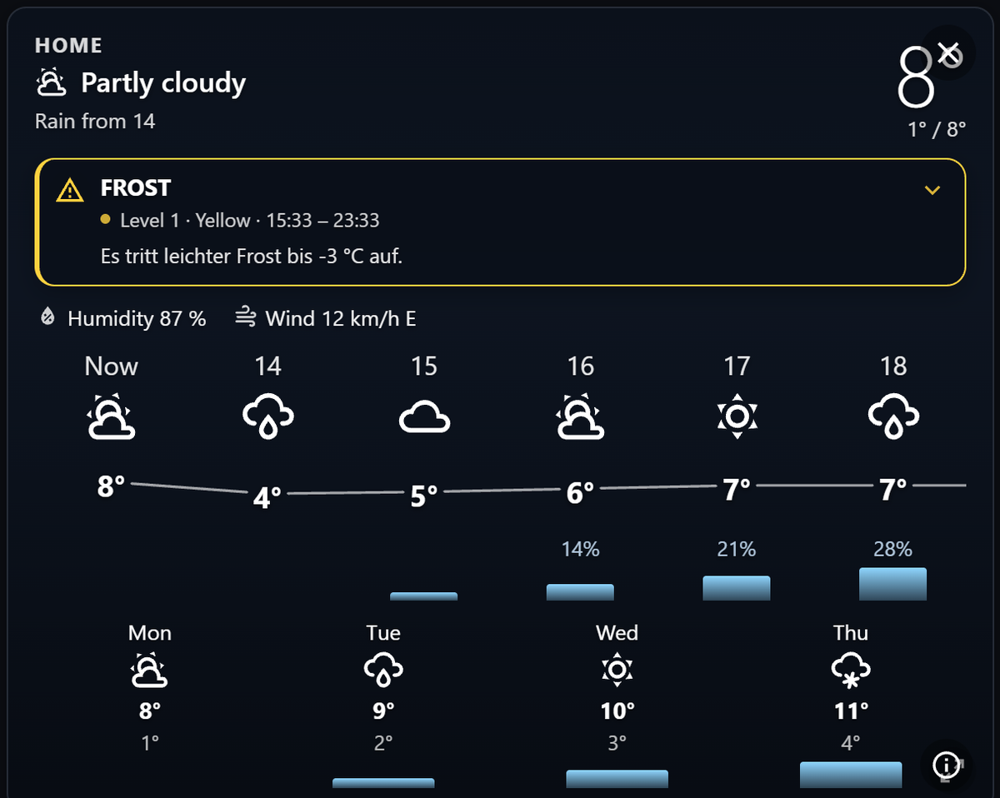
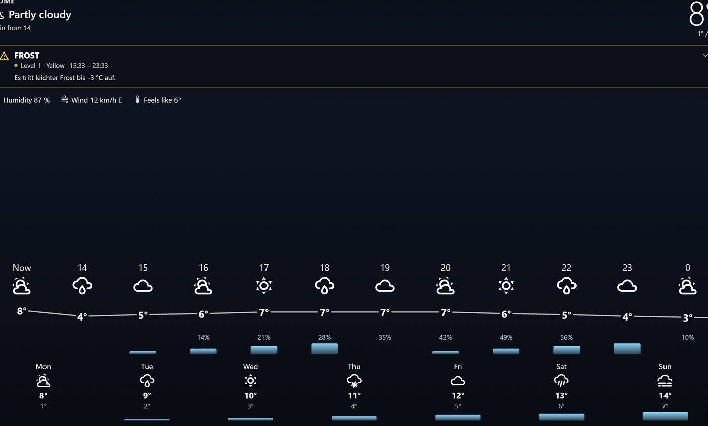
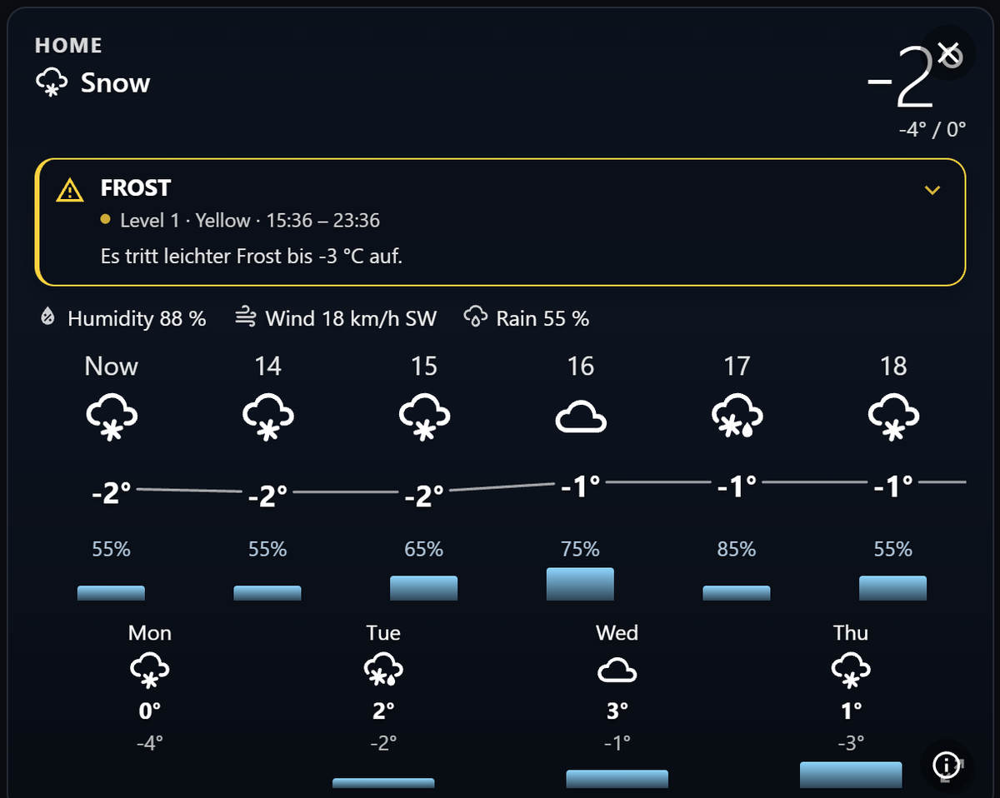

# SkyShield Weather Card

An animated sky for Home Assistant that carries its severe-weather warnings **inside the card**.

The card paints a living sky behind its own content — sun, moon with its real phase, stars,
drifting clouds, rain, snow, fog and lightning, all following the weather entity and the sun's
position. The warning band sits on top of that sky, so warnings never look like a second card
bolted on.



[](https://github.com/Pissbirne/skyshield-weather-card/releases)

See the [release notes](https://github.com/Pissbirne/skyshield-weather-card/releases) for what changed,
and the [options](#options) for every configuration switch.

## Features

- **Sky per condition** — gradient and effects follow the entity state; day, dusk and night come
  from `sun.sun` (elevation interpolated, not switched).
- **Sun and moon** — the sun is drawn only while it is really up, the moon only at night, with its
  current phase.
- **Weather in motion** — rain slanted by the real wind speed, drifting snow, layered fog,
  lightning flashes, drifting clouds. Stops when the card is off screen or the tab is hidden.
- **Warnings inside the card** — DWD (`warning_N_*`), MeteoAlarm/CAP (`awareness_level`),
  Environment Canada / Pirate Weather (`alert_N`) and plain text states are detected
  automatically. Sorted by severity, expired ones filtered out.
- **Warning text** — the short text is always visible, the advice below it opens on tap.
- **Hourly strip with a temperature curve** — curve is optional and never runs through the values.
- **Scrollable strip** — up to 48 hours behind the visible slots; drag with the mouse or swipe on a
  phone, the curve travels with it. Slots snap into place, one switch turns it off.
- **Precipitation bars** — one bar per hour and per day, scaled to the wettest column shown; one switch
  for both.
- **Next precipitation** — a line under the condition: when the next rain or snow starts.
- **Full-screen zoom** — tap the card (wide screens only) for 12 hours and 7 days plus more
  current values. Off on phones, can be disabled for wall tablets.
- **Scales per device** — `font_scale` adjusts every size, icon and the curve geometry.

## Installation

### HACS / Marketplace (recommended)

1. HACS → ⋮ → **Custom repositories** → add `https://github.com/Pissbirne/skyshield-weather-card`, category **Dashboard**.
2. Install **SkyShield Weather Card**, then reload the browser once.
3. Add the card and pick your weather entity — the rest has switches in the card editor.

### Manual

1. Copy `skyshield-weather-card.js` to `/config/www/community/skyshield-weather-card/`.
2. Settings → Dashboards → ⋮ → Resources → add
   `/local/community/skyshield-weather-card/skyshield-weather-card.js` as **JavaScript module**.
3. Add the card and pick your weather entity.

```yaml
type: custom:skyshield-weather-card
entity: weather.home
sun_entity: sun.sun
warning_entities:
  - sensor.dwd_current_warning_level
```

## Options

| Option | Default | Description |
|---|---|---|
| `entity` | — | Weather entity (required) |
| `sun_entity` | `sun.sun` | Sun entity for day/night, sunrise and sunset |
| `warning_entities` | `[]` | Sensors carrying warnings |
| `name` | entity name | Label above the temperature |
| `hours` | `6` | Slots visible in the hourly strip, `0` hides it |
| `scroll_hours` | `true` | Strip holds more hours than fit; drag or swipe sideways |
| `hours_total` | `24` | Hours in the strip when scrolling is on (up to 48) |
| `days` | `4` | Days in the forecast, `0` hides it |
| `compact` | `false` | Hides strip and forecast |
| `animate` | `true` | Off draws a still frame |
| `show_warnings` | `true` | Off never shows a warning band |
| `show_warning_text` | `false` | On keeps the advice open permanently |
| `show_curve` | `true` | Temperature curve in the strip |
| `show_rain_bars` | `true` | Precipitation bars under the hours and the days |
| `show_next` | `true` | "Rain from …" line under the condition |
| `zoom` | `auto` | `auto`, `always` or `off` |
| `font_scale` | `1` | 0.8–1.8, scales every size |

Every option is in the visual editor, no YAML required.

## Notes

- Warning texts come from the source integration, so they stay in its language (DWD → German).
- The card is a plain `HTMLElement` with a canvas; no Lit runtime, no dependencies.
- `prefers-reduced-motion` renders a still sky.

## Screenshots

| Normal | Full-screen zoom |
|---|---|
|  |  |

Snow, as the sky renders it — icons, temperatures and the warning all follow the same weather:



## License

MIT — see [LICENSE](LICENSE).
